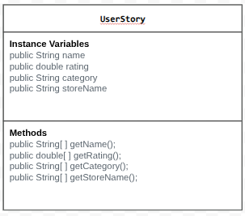

# Unit 2 - Data for Social Good Project

## Introduction

Software engineers develop programs to work with data and provide information to a user. Each user has different needs based on the information they are looking for from data. Your goal is to create a data analysis program for your user that stores and analyzes data to provide the information they need.

## Requirements

Use your knowledge of object-oriented programming, one-dimensional (1D) arrays, and algorithms to create your data analysis program:
- **Write a class** – Write a class to represent your user or business and store and analyze their data with no-argument and parameterized constructors.
- **Create at least two 1D arrays** – Create at least two 1D arrays to store the data that your user needs information about.
- **Write a method** – Write a method that finds or manipulates the elements in a 1D array to provide the information your user needs.
- **Implement a toString() method** – Write a toString() method that returns general information about the data (for example, number of values in the dataset).
- **Document your code** – Use comments to explain the purpose of the methods and code segments and note any preconditions and postconditions.

## User Story 

Include your User Story you analyzed for your project here. Your User Story should have the following format: 

> As an [role],   
> I want to [goal],   
> so that I can [benefit].

“As a shopping enthusiast,
I want to look for stores that carry the item(s) I want and have quality products
so I can find the best clothes for my closet.”

## Dataset 

Include a hyperlink to the source of your dataset used for this project. Additionally, provide a short description of each column used from the dataset, and the data type. 

Example: 
Dataset: https://www.kaggle.com/datasets/sansuthi/global-co2-emissions 
- **Country** (String) - name of the country 
- **Population** (int) - number of people in the country 
- **CO2Emissions** (double) - carbon dioxide emission in kilotons 

Dataset: https://docs.google.com/spreadsheets/d/1mpmsaVyVPnV-F7pOv-cWYOSaqAihGMscpgo3nDXdGSM/edit?gid=2042599254#gid=2042599254

- **ItemName** (String) - specific  item names
- **Category** (String) - category the item falls under
- **StoreName** (String) - what store each item is from
- **UserRating** (double) - represents rating of quality

## UML Diagram 

Put an image of your UML Diagram here. Upload the image of your UML Diagram to your repository, then use the Markdown syntax to insert your image here. Make sure your image file name is one work, otherwise it might not properly get displayed on this README. 

![UML Diagram for my project]

## Description 

Write a description of your project here. In your description, include as many vocab words from our class to explain your User Story, the chosen dataset and how your project addressed that users goals. If your project used the Scanner class for user input, explain how the user will interact with your project.

For my Data for Social Good project, I created a program to help shopping enthusiasts find stores that sell the clothing items they want and have good-quality products. My dataset includes four pieces of information: ItemName, Category, StoreName, and UserRating. I used 1D arrays to store multiple values, such as item names, categories, store names, and ratings. I also used a class and objects to organize the data and used a FileReader to read information from a text file. My program uses algorithms, including loops and conditional statements, to search through the data and find items with ratings of 4.5 or higher. This helps users find stores that carry the items they are looking for and compare product quality. I also used a toString() method to display general information about the data. Overall, this project helped me understand how Java concepts can be used to organize and analyze real-world data to make shopping easier for users.